# How Explainability Works in the AEM Equipment Service Assistant

**Date:** 12 Oct 2026 · **Status:** Describes the current implementation
**Code:** `src/asa/components/explanation.py` (the Explanation Module), `app/services/chat_service.py` (how its result is used)
**Related:** `docs/explainability-strategy.md` (design rationale and roadmap)

---

## 1. In one paragraph

Every answer the assistant gives is checked against the equipment manual **after** the agents have produced it. The Explanation Module breaks the answer into individual claims and looks for the exact manual sentence (or table row) that supports each one. It then computes an **evidence confidence** from what it found, and writes a plain-language reason for the answer's status. It never calls an AI model, never changes the answer, and never invents a quote: anything it cannot find word-for-word in the retrieved manual passages is reported as *unverified*. Below a confidence of **0.70**, the answer is still shown, but it is flagged for human review with a "verify with a qualified engineer" warning.

---

## 2. What the user gets

Each chat response carries an `explanation` object alongside the answer:

| Field | What it means | Example |
|---|---|---|
| `confidence` | Evidence confidence from 0 to 1 (a transparent score, **not** a probability) | `1.0` |
| `confidence_level` | `low` (< 0.50), `medium` (0.50–0.69) or `high` (≥ 0.70) | `high` |
| `citations` | Up to 8 exact quotes from the manual, each with file, page, section, revision and chunk ID | see §5 |
| `claims_checked` / `claims_verified` | How many claims in the answer were checked, and how many were backed by a quote | `6` / `6` |
| `decision.why` | Why the answer has this status, in one sentence | "Answered from 3 cited manual passage(s); 6 of 6 claim(s) were matched to a manual sentence." |
| `decision.status`, `specialist`, `verdict` | The outcome, which agent answered, and the Safety verdict (if any) | `ok`, `agentic_rag`, — |
| `notes` | Plain-language observations about the evidence | "The answer is supported by 3 different manual sections." |

The response's `sources` list shows the manual passages the answer is **verified** to rely on. If nothing could be verified, it falls back to the passages that were retrieved, so the user still sees where the assistant looked. When confidence is below 0.70, `safety.warning` carries the "verify" message and `safety.requires_human_review` is `true`.

No explanation is produced for clarification questions, blocked requests or unavailable responses, because there is no answer to explain.

---

## 3. Where it sits in the pipeline

```mermaid
flowchart LR
    Q[Engineer question] --> G[Input guardrails<br/>injection scan, PII redaction]
    G --> A[LangGraph agents<br/>Request → Planning → RAG / Diagnostic / Safety]
    A --> H[Rule-based hazard check<br/>can only add caution]
    H --> E[Explanation Module<br/>explain&#40;state, status&#41;]
    E --> F[Confidence gate<br/>below 0.70 → verify warning]
    F --> R[Response, audit log,<br/>metrics, Langfuse scores]
```



It runs **after** the hazard check on purpose: if the hazard rules withhold an answer, the module explains what the user is actually shown (the escalation message), not the withheld text.

---

## 4. Step by step: how an answer is explained

### Step 1 — Split the answer into claims

The module finds the claims to check in one of three ways, using the first that applies:

| Source | Used for | How claims are found | Strictness |
|---|---|---|---|
| **Citation markers** | RAG answers | Each sentence carrying `[Source: file, page N, section X]`, before or after its full stop | **Strict**: checked only against the page it cites |
| **Structured claims** | Diagnostic and Safety answers | Root causes, troubleshooting steps and safety claims, each listing the chunk IDs that support it | Checked against those chunks first |
| **Answer lines** | Fallback (e.g. a plain Safety answer) | Each line of the answer | Checked against any retrieved passage |

Strict checking matters: if the answer says "page 118" but the sentence is really on page 117, the claim is reported as **unverified** rather than being quietly matched elsewhere.

### Step 2 — Find the supporting quote

For each claim, the module searches the relevant manual passages for the best-matching **sentence**:

- Words are compared after dropping common filler words; a candidate must share **at least 3 content words** with the claim and reach a **similarity of 0.30** (cosine similarity of the two word sets).
- Page headers, tables of contents and other "page furniture" are never quoted.
- **Tables:** the PDF text puts each table cell on its own line, so a table has no sentences. When no prose sentence supports a claim, short runs of consecutive cells (up to 6, i.e. a table row) become candidates. A row that starts with the claim's own label wins: a claim about the "PDU" quotes the PDU row, not the Chiller row below it or a column header.

### Step 3 — Reject matches that mean something different

Word overlap alone cannot tell "Spring washers **must not** be reused" from "Spring washers **must** be reused". Two extra checks reject a candidate even when its words match:

- **Negation:** one side contains *not, no, never, cannot, without, …n't* and the other does not.
- **Numbers:** the claim contains a number that the quote does not (e.g. "80 A" against the manual's "63 A", or "every 3 months" against "every 6 months").

A claim rejected only for these reasons is counted as *contradicted*, and the user is told so.

### Step 4 — Never invent a quote

The chosen quote must appear **word-for-word** in the retrieved passage (after collapsing line breaks and spaces). If it does not, the claim is unverified. Quotes are capped at 300 characters, and duplicate citations are removed.

### Step 5 — Compute the evidence confidence

The score starts at a base value, earns bonuses for strong evidence, and is then capped by any weakness. All weights are **provisional** and are meant to be tuned with subject-matter experts.

| Factor | Effect |
|---|---|
| Base | **0.50** |
| The RAG agent judged the retrieved evidence sufficient | **+0.20** |
| The citations come from 2 or more different manual sections | **+0.15** |
| Share of claims verified | **+0.15 × verified ÷ checked** |
| Each extra retrieval attempt | **−0.15** each, at most −0.30 |
| No manual sentence could be quoted at all | capped at **0.40** |
| Some claims are not backed by a quote | capped at **0.65** (below the 0.70 floor) |
| A claim contradicts its manual sentence | capped at **0.45** |
| The run escalated to a human | capped at **0.30** |

The result is rounded to two decimals and mapped to a level: **low** below 0.50, **medium** from 0.50 to 0.69, **high** from 0.70.

### Step 6 — Explain the decision

`decision.why` gives the reason for the status in one sentence. It never claims more support than the counts show:

| Situation | Reason given |
|---|---|
| Escalated | The escalation reason recorded by the agents |
| Halted | The Safety Agent's reason (the manual prohibits the action) |
| Diagnostic answer | Candidate conditions and checks were validated against the cited passages; the root cause is not confirmed |
| Safety answer | The Safety Agent's reason |
| RAG answer | "Answered from N cited manual passage(s); V of C claim(s) were matched to a manual sentence." (or that none could be matched) |

### Step 7 — Act on the result

Back in the chat pipeline (`chat_service.py`):

- **Confidence gate:** if the status is `ok` and confidence is below **0.70**, the answer is still shown but `requires_human_review` is set and the warning *"Low evidence confidence (0.65): verify with a qualified engineer before acting."* is added (after any hazard warning). Like the hazard rules, it can only add caution; it never changes the answer or its status.
- **Sources:** the verified cited passages become the response's `sources`.
- **Shared state:** `confidence` and `citations` are written into the shared state as `Citation(doc_id, section_id, revision, quote_span)` objects, as defined in `src/asa/graph/state.py`.
- **Audit and monitoring:** the audit log records the confidence, its level, whether an explanation was produced and whether human review is required; Langfuse receives the confidence as a score; `/api/monitoring` reports the low-confidence rate.

---

## 5. Worked examples

These come from real runs against the AEM 1kW Thermal Retrofit manual.

### Example A — "What are the facility requirements?"

The answer listed water, electrical and other requirements taken from two specification tables, with six cited claims.

| Factor | Contribution |
|---|---|
| Base | 0.50 |
| Evidence judged sufficient | +0.20 |
| 3 sections cited (3.1 Facility Requirements, 3.2 Mechanical Specification, 3.3.1.1 Chiller Specification) | +0.15 |
| 6 of 6 claims verified | +0.15 |
| **Confidence** | **1.00 (high)** |

A citation from this answer, quoting a table row:

```json
{
  "source_file": "aem_1kw_thermal_retrofit_system.pdf",
  "page": 40,
  "section": "3.3.1.1 Chiller Specification",
  "quote": "Facility Water Supply Temperature Range 15~25℃",
  "chunk_id": "aem_1kw_thermal_retrofit_system_p40_c0",
  "doc_id": "aem_1kw_thermal_retrofit_system",
  "section_id": "aem_1kw_thermal_retrofit_system#p40#3_3_1_1_chiller_specification",
  "revision": "unknown",
  "quote_span": "Facility Water Supply Temperature Range 15~25℃"
}
```

The `quote` is the table row exactly as it appears in the manual (four table cells joined by spaces). `revision` is "unknown" because the document metadata does not yet record the manual's revision (see §8).

### Example B — "List all the potentially hazardous energy sources"

| Factor | Contribution |
|---|---|
| Base | 0.50 |
| Evidence judged sufficient | +0.20 |
| Only 1 section cited (2.5 Safety Hazard) | +0.00 |
| 1 of 1 claim verified | +0.15 |
| **Confidence** | **0.85 (high)** |

The answer also carries a hazard warning (stored energy), added by the rule-based hazard check, not by the Explanation Module.

### Example C — An answer with one invented claim (test case)

An answer with one supported claim and one invented claim ("Lubricate the compressor bearings with grade 5 grease") gets 1 of 2 claims verified. Before the unverified cap it would score 0.77 (high); with the cap it is **0.65 (medium)**, the reason reads *"1 of 2 claim(s) were matched to a manual sentence"*, and the confidence gate adds the "verify" warning.

### Example D — A claim that reverses the manual (test case)

"Spring washers **should be** reused" is matched by its words to the manual's "Spring Washers should **not** be reused", but the negation check rejects the match. The claim is unverified, the note *"1 claim(s) appear to contradict the cited manual sentence (negation or numbers differ): verify them."* is added, and confidence drops to **0.40 (low)**.

---

## 6. Design principles

| Principle | How it is applied | Basis in the course material |
|---|---|---|
| **Explanations come from evidence, not from the model narrating its reasoning** | No LLM call in the module; all text comes from templates filled with counted facts | IMDA *Model AI Governance Framework for Agentic AI*: chain-of-thought "may not be a faithful explanation of the agent's actions" |
| **Add no new facts** | Every quote must appear word-for-word in a retrieved passage; anything else is unverified | ArchAAS Day 3: explainability through provenance and audit |
| **Report confidence and why** | Score with visible factors, notes and a reason | IMDA *Model AI Governance Framework* (2nd ed.): systems can report confidence and explain why |
| **Only ever add caution** | The confidence gate and the hazard rules can flag or withhold, never loosen | ArchAAS Day 4: safety gates before and after the response |
| **Guard against over-trust** | Unverified and contradicted claims are reported explicitly, never hidden | OWASP agentic risk ASI09 (human–agent trust exploitation); IMDA on automation bias |
| **Deterministic and repeatable** | Same input, same output; no tokens or latency added | IMDA MGF: repeatability and traceability |

---

## 7. How it is tested

- **Unit tests** (`tests/unit/test_explanation.py`) cover, among others:
  - quotes are exact text from the passage;
  - markers before and after a full stop;
  - strict page checking;
  - negation and number contradictions;
  - specification-table rows, and choosing the correct row label;
  - tables of contents are never quoted;
  - the confidence arithmetic and caps;
  - the reason text;
  - the shared-state citation fields;
  - the module never changes its input;
  - random input never breaks the rules.
- **Pipeline tests** (`tests/test_chat.py`) cover:
  - the confidence gate and its warning;
  - sources taken from citations, with the fallback;
  - writing the result to the shared state;
  - a failing Explanation Module never breaks the answer.
- **Live tests** (`pytest tests/live --run-openai`, a few cents) check real grounded answers and a real safety question end to end.

---

## 8. Known limitations

| Limitation | Effect | Possible next step |
|---|---|---|
| Matching is by shared words, not meaning | A correct paraphrase may be reported as unverified; this errs on the side of caution | Offline faithfulness evaluation with an LLM judge (e.g. DeepEval) to measure this |
| The confidence weights are provisional | The score is a transparent heuristic, not a calibrated probability | Calibrate against an SME-labelled evaluation set and `/api/feedback` ratings |
| Negation and number checks are word-based | Numbers written as words ("six") and implicit negation are not caught | Extend the checks; add regression cases from real failures |
| The frontend shows only the confidence badge, sources and warnings | Quotes, notes and the reason are in the API response but not yet displayed | Add a "Why this answer?" panel |
| The module runs after the graph | Its results do not appear inside the LangGraph trace itself | Move it into the graph as an `explain` node (needs team agreement on `state.py`) |
| Low confidence warns but does not escalate | A weak answer is still shown, with a warning | Decide an escalation threshold once the low-confidence rate has been measured |
| The manual revision is not recorded | Citations show `revision: "unknown"`, although the manual pages say "Rev 0" | Set the revision in the document registry (`src/asa/ingestion/metadata.py`) so every citation names the manual edition |

See `docs/explainability-strategy.md` for the full roadmap.
