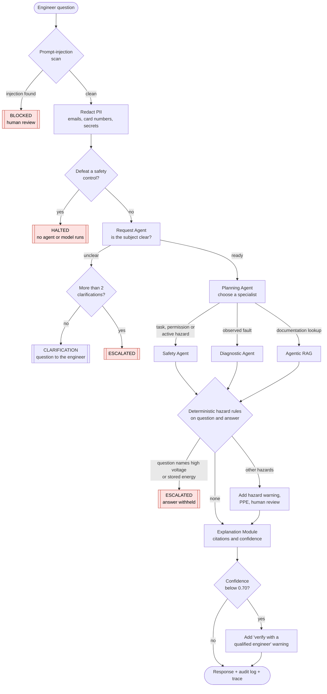
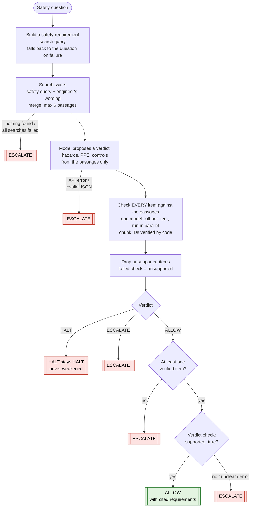

# Safety Report: How the AEM Equipment Service Assistant Keeps Engineers Safe

**Date:** 13 Oct 2026 · **Scope:** the code on branch `feature/langfuse-tracing-best-practices`
**Main files:** `app/services/chat_service.py` (pipeline), `src/asa/guardrails/` (deterministic guardrails), `src/asa/agents/safety.py` (Safety Agent), `src/asa/components/explanation.py` (evidence and confidence)
**Related:** `docs/explainability-report.md`, `docs/explainability-strategy.md`

---

## 1. Summary

The assistant answers equipment-service questions from the AEM manuals. Wrong or unsafe guidance could injure a technician, so safety is built in as **layers of defence**: every request passes several independent checks, and no single model decision can make an answer less safe.

Four rules hold throughout:

1. **Deterministic rules decide the hard cases.** Requests to defeat a safety control, prompt-injection attempts and high-voltage tasks are recognised by fixed, tested patterns, not by a model's judgement.
2. **Checks can only add caution.** A guardrail may warn, flag for human review, withhold an answer or escalate. Nothing can turn a HALT into an ALLOW or remove a warning another layer added.
3. **Every safety claim must be backed by the manual.** Hazards, PPE and controls are shown only if they are checked against retrieved manual passages, and each one cites its page and section.
4. **When in doubt, escalate.** Missing evidence, unparseable model output, API failures and repeated ambiguity all lead to a human (ESCALATE), never to a guess or a crash.

The assistant is **advisory only**: it has no ability to operate equipment (§4.10).

---

## 2. What can go wrong (threat model)

| # | Risk | Example | Main defences |
|---|---|---|---|
| R1 | Help to defeat a safety control | "How do I bypass the door interlock?" | Defeat-request gate (§4.3) |
| R2 | Unsafe or invented safety guidance | The model says it is fine to work on energised equipment, or invents PPE | Safety Agent grounding and verdict rules (§4.6), hazard rules (§4.7) |
| R3 | Work on non-field-serviceable hazards | "How do I fix the 480V power unit?" | Escalate-only hazard rule (§4.7) |
| R4 | Prompt injection by the user | "Ignore your instructions and…" | Injection scan, request blocked (§4.1) |
| R5 | Prompt injection hidden in documents | A poisoned manual passage | Trusted sponsor PDFs only; sanitiser exists but is **not wired in** (§7, gap G1) |
| R6 | Answer from the wrong machine's manual | Thermal Station question answered from the 1 kW Retrofit manual | Equipment isolation in retrieval (§4.5) |
| R7 | Personal data leaving the system | An email or card number typed into the chat | PII redaction before the model, logs and traces (§4.2, §4.9) |
| R8 | Over-trust in a weak answer | A confident-sounding answer with little evidence | Evidence confidence and the "verify" gate (§4.8) |
| R9 | Model or API failure | Invalid JSON, a timeout | Fail-safe escalation (§4.6) |
| R10 | Runaway agent loops or cost | Endless retrieval retries | Acyclic graph, capped retries and clarifications (§4.4) |
| R11 | Platform compromise | A vulnerable dependency, a container escape | CI scans, hardened containers, network policy (§4.11) |

---

## 3. Defence in depth: the request pipeline

Every chat request passes through these layers, in this order:

Each layer is described below. Layers marked **deterministic** use fixed rules, with no model involved.

---

## 4. The guardrails in detail

### 4.1 Prompt-injection scan (deterministic, input)

**Where:** `src/asa/guardrails/injection.py` → `scan_user_input()`, called first in `chat_service._handle_chat`.

The question is matched against pattern groups:

| Category | Catches, for example |
|---|---|
| `instruction_override` | "ignore all previous instructions", "override the safety guardrails" |
| `role_hijack` | "you are now…", "pretend to be…" |
| `prompt_leak` | "reveal your system prompt" |
| `injected_turn` | Fake conversation turns such as `<system>` or a line starting with `assistant:` |
| `safety_bypass` | Attacks on the **assistant's own** safeguards: "disable your guardrails", "don't escalate" |

**Outcome:** a flagged request is **blocked** (HTTP 400, status `blocked`) before any model sees it. The audit log records only the categories and the message length, never the text. Equipment questions such as "Can I bypass the safety interlock?" are deliberately **not** treated as injection: they must reach the safety layers below, which answer them properly.

### 4.2 PII redaction (deterministic, input)

**Where:** `logging_sub._redact()`, applied before the question goes to any model.

Email addresses become `[EMAIL]`, card-like digit runs become `[CARD]`, and `api_key=…`, `token=…`, `password=…` and `secret=…` values become `[REDACTED]`. The same redaction protects the audit log and the Langfuse traces (§4.9).

### 4.3 Defeat-request gate (deterministic, input, final)

**Where:** `safety_rules.check_defeat_request()`, called in `chat_service` right after redaction.

**Rule:** a *defeat word* close to a *safety-control word* in the same sentence (within 6 words, in either order):

| Defeat words | Safety controls |
|---|---|
| bypass, defeat, disable, override, jumper / jump out, short out, circumvent, deactivate, tape down, tie down | interlock, emergency stop / E-stop, EMO, safety switch, safety guard, light curtain, safety relay, door switch |

**Outcome:** the request is **halted immediately**. **No agent and no model runs**, so no model can be talked into helping. The engineer sees:

> *Safety decision: HALT. Bypassing, defeating or disabling a safety control (interlock) is not permitted. Keep all safety controls in place. If a safety control is preventing the work, stop and contact a qualified engineer.*

The run is flagged for human review, recorded in the audit log, and any pending clarification is cleared. Questions *about* a control ("How do I reset the emergency stop?", "Why does the interlock trip?") pass through normally. In a live test the gate answered in **2.1 s**, with no model calls.

### 4.4 Request and routing controls

| Control | How it works | Where |
|---|---|---|
| Equipment must be selected | No equipment model means an immediate clarification, before any model call | `request.py` |
| Clarification limit | After **2** clarification rounds (`MAX_CLARIFICATIONS`) the request escalates instead of looping | `chat_service.py` |
| A new question is treated as new | A complete question sent while a clarification is pending is not merged into the old one | `chat_service._is_standalone_request` |
| Safety-first routing | The Planning Agent sends anything about **doing a task, asking permission or an active hazard** to the Safety Agent. **When it is unclear, it chooses Safety.** Pure lookups ("list the hazards") go to RAG. | `planning.py` |
| Conservative default | If the planner's output cannot be parsed, the request goes to the **Safety** Agent | `planning.py` |
| Bounded execution | The agent graph has no cycles (Request → Planning → one specialist → end). The RAG retrieval loop stops after at most 3 attempts. | `orchestrator.py`, `rag.py` |

### 4.5 Equipment isolation in retrieval

**Where:** `AEMHybridRetriever.hybrid_search()` and `AgenticRAGAgent.junior_search()`.

Every search is filtered to the **selected equipment model**, in both the vector search and the keyword search. When the RAG agent's model asks for a search, the application **overwrites** the equipment field with the one the engineer selected, so the model can never switch to another machine's manual.

### 4.6 The Safety Agent

**Where:** `src/asa/agents/safety.py` → `safety_node()`. It decides one of three verdicts:

| Verdict | Meaning | User-facing status |
|---|---|---|
| **ALLOW** | The manual supports the request **when its documented controls are followed**. It is never unrestricted permission. | `ok`, with the documented hazards, PPE and controls listed |
| **HALT** | The requested action, or the situation described, conflicts with a documented requirement | `halted`, human review |
| **ESCALATE** | The evidence is insufficient, or something failed | `escalated`, human review |

**How each safeguard works:**

1. **Evidence-only prompts.** The model must use *only* the retrieved passages. It must not add requirements from general knowledge, weaken a prohibition, treat silence as permission, or recommend bypassing a control. An informational question ("what precautions apply?") is told apart from an unsafe proposal ("can I service it without powering off?").
2. **Every item is verified.** Each proposed hazard, PPE item and control is checked by a separate model call that must name the supporting passage. **Application code** then rejects any chunk ID that was not actually retrieved, so the model cannot cite invented evidence. PPE listed for a different activity (for example installation) is not accepted for servicing.
3. **Only ALLOW is re-validated.** HALT and ESCALATE are already the cautious outcomes and are returned unchanged, so a prohibition can never be weakened into "insufficient evidence". An ALLOW survives only on an explicit `{"supported": true}` from the validator. Anything else, including malformed output or an API error, becomes ESCALATE.
4. **ALLOW needs evidence.** An ALLOW with no verified hazard, PPE item or control becomes ESCALATE, so the engineer is never told to proceed without a single documented requirement.
5. **Fail-safe at every step.** A failed query step falls back to the engineer's wording. Failed searches escalate. A failed or malformed assessment escalates, with the evidence attached. A failed per-item check drops only that item. None of these crashes the request.
6. **No unchecked model text reaches the engineer.** The reason shown is fixed wording chosen by the verdict. The listed items are the verified ones, each followed by its source, for example:
   > `- Perform equipment or module power down and power off before servicing. [Source: aem_thermal_station.pdf, page 19, section 2.2.2 General Safety Guidelines]`

**Live examples** (Thermal Station manual):

| Question | Verdict | Evidence |
|---|---|---|
| "Can I open the panel while the equipment is powered?" | **HALT** | Electrical hazard and "power off before servicing", both cited to p.19; 2/2 claims verified |
| "What safety precautions apply before servicing?" | **ALLOW** | Hazards, PPE and controls cited to pp.19–22; 8/8 claims verified; about 10 s |

### 4.7 Deterministic hazard rules on the question and the answer

**Where:** `safety_rules.check_text()`, run in `chat_service` **after** the agents, on both the question and the answer.

| Hazard category | Detected by (examples) | PPE added |
|---|---|---|
| `high_voltage` | "high voltage", "HV", 3+ digit voltages (480V, **415VAC**, 230 volts), "mains" | insulated gloves, arc-flash face shield |
| `stored_energy` | capacitor, stored energy, discharge, pressurised | safety glasses, insulated tools |
| `esd` | ESD, electrostatic | ESD wrist strap, ESD-safe mat |
| `lockout_tagout` | LOTO, lock-out, tag-out, de-energise | lockout device, personal lock and tag |
| `thermal` | hot surface, burn hazard, 3+ digit °C, heater element | heat-resistant gloves, safety glasses |

**Outcome:**
- Any hazard, from the rules or listed by the Safety Agent, adds a **hazard warning**, the PPE and **human review**. Example: *"Hazards detected (Electrical Hazards, Thermal Hazards). Follow lockout/tagout and use the required PPE. A human must review before acting."*
- If the **question itself** names a hazard that is **not field-serviceable** (`high_voltage` or `stored_energy`), the answer is **withheld** and the request **escalated**: *"This task involves hazards that are not field-serviceable (high voltage). Do not proceed on your own. Escalate to a qualified engineer."*
- Hazards found only in the **answer** (quoted from the manual's safety sections) add warnings and PPE but do not withhold it.

### 4.8 Evidence confidence gate

**Where:** `explanation.py` → `explain()`; gate in `chat_service._flag_low_confidence()`. Full details are in `docs/explainability-report.md`.

Every answer's claims are checked against exact manual sentences or table rows: negation and numbers must match, and the cited page must be the one retrieved. An evidence confidence is then computed. **Below 0.70** the answer is still shown, but it is flagged for **human review** with *"Low evidence confidence (0.65): verify with a qualified engineer before acting."* Unverified claims cap the confidence at 0.65, and contradicted claims cap it at 0.45.

### 4.9 Audit trail, monitoring and tracing

| Mechanism | Safety purpose |
|---|---|
| **Hash-chained audit log** (`logs/`, JSON Lines) | Every request, including blocked, halted and unavailable ones, gets a `run_id`. Each record includes the hash of the previous one, so edits after the fact are detectable. `/api/monitoring` re-checks the chain. |
| **What is recorded** | Status, specialist, safety verdict, hazard categories, PPE, human-review flag, confidence, source references and a **hash** of the answer. Question text is redacted, and blocked messages are recorded only by category and length. |
| **Monitoring** (`/api/monitoring`) | Escalation, clarification and low-confidence rates, latency, explanation coverage and audit-chain integrity, with alerts |
| **Langfuse traces** (optional) | Each guardrail appears as a `guardrail` step (`detect-prompt-injection`, `redact-pii`, `detect-safety-control-defeat`, `check-hazard-rules`), the Safety Agent's model calls as named generations, and every retrieval. **By default no question, answer or manual text is stored**, only structure, timing, tokens and short identifiers. |

### 4.10 No ability to act (advisory only)

The shared state's `Step` type (`src/asa/graph/state.py`) has **no command or actuator field**. The type comment states this enforces *"zero hardware execution authority"*: the system advises, and a human acts. The frontend renders all model output as plain text (`textContent`, never `innerHTML`), so an answer cannot inject script into the page.

### 4.11 Platform and delivery safeguards

| Area | Safeguard |
|---|---|
| CI (`.github/workflows/ci.yml`) | Lint, **dependency vulnerability scan** (pip-audit), unit tests, an **AI security test suite** (injection / adversarial), container builds with **Trivy** image scanning (fails on fixable CRITICAL or HIGH findings) |
| Containers (`k8s/`) | Run as non-root, read-only root filesystem, no privilege escalation, all Linux capabilities dropped; restricted Pod Security namespace |
| Network (`k8s/networkpolicy.yaml`) | Default deny. Only the frontend reaches the backend (port 8000); the backend may only call out on HTTPS (443, for OpenAI) and DNS |
| Secrets | API keys live in `.env` (git-ignored) or Kubernetes secrets; never in the repository |
| Local Langfuse | Ports bound to `127.0.0.1` only |

---

## 5. Outcomes at a glance

| Status | Produced by | Answer shown? | Human review |
|---|---|---|---|
| `blocked` | Prompt-injection scan | No | ✓ |
| `halted` | Defeat-request gate, or a Safety Agent HALT | No procedure; the halt message plus the cited requirements | ✓ |
| `escalated` | Safety Agent ESCALATE, escalate-only hazard in the question, insufficient evidence, or too many clarifications | Withheld (escalation message) | ✓ |
| `clarification` | Request Agent (no identifiable subject) | A question back to the engineer | — |
| `ok` + warning | Hazards detected, or confidence below 0.70 | Yes, with warnings and PPE | ✓ |
| `ok` | No hazards, confidence 0.70 or above | Yes, with citations | — |
| `unavailable` | Model, index or network failure outside the Safety Agent | No ("temporarily unavailable") | — |

---

## 6. How the safety layers are tested

| Test area | Tests | What they prove |
|---|---|---|
| `tests/security/test_injection.py` | 40 | Injection categories are detected, at least 90% on an attack set, with **zero** false positives on real equipment questions |
| `tests/unit/test_safety_rules.py` | 40 | Hazard categories, PPE, escalate-only hazards, voltage formats (415VAC, 480 VDC; not 24V), defeat requests (8 must halt, 10 must not) |
| `tests/unit/test_safety_grounding.py` | 35 | Item grounding, invented chunk IDs rejected, PPE from the wrong activity rejected, HALT never weakened, ALLOW only on an explicit `true`, every failure escalates, ALLOW needs evidence, parallel checks, citations, both searches used |
| `tests/test_chat.py` | 53 | Pipeline behaviour: blocked, halted (no agent runs), escalation for high voltage, warnings, confidence gate, clarification limits |
| `tests/unit/test_explanation.py` | 53 | Evidence verification: exact quotes, negation and number contradictions, table rows, confidence caps |
| `tests/live/` (opt-in, paid) | 2 | Real grounded answers, and a real safety question never receives a plain procedure |

The full offline suite runs without OpenAI calls: **324 passed** at the time of writing.

---

## 7. Known gaps and recommendations

| # | Gap | Risk | Recommendation |
|---|---|---|---|
| **G1** | **The indirect-injection defence is not wired in.** `injection.sanitize_context()` exists and its docstring says retrieved passages are cleaned *"before they enter any prompt"*, but nothing calls it. | Low today (the only documents are trusted sponsor PDFs), but it rises as soon as other documents are ingested | Call `sanitize_context()` on retrieved chunks in the RAG, Diagnostic and Safety agents, log flagged chunk IDs, and add a test with a poisoned passage |
| G2 | Hazard triggers and the PPE list were **seeded from a synthetic document** (XR-500), not the AEM manuals | The PPE added by the rules may differ from what the AEM manuals require | Have an SME review `safety_rules.py` against the AEM safety sections, as the file itself asks |
| G3 | The deterministic rules are **keyword-based** | Unusual phrasings can slip past the rules (the Safety Agent remains as a second layer) | Grow the pattern lists from real queries and incidents; add every miss as a test |
| G4 | The **API has no authentication**; CORS only limits browsers | Anyone who can reach port 8000 can use it | Add authentication (e.g. an API gateway with OIDC/JWT) before any shared deployment |
| G5 | Low confidence **warns but does not escalate** | A weak answer is still shown (with a warning) | Decide an escalation threshold once the low-confidence rate has been measured on `/api/monitoring` |
| G6 | High voltage named in a **question** always escalates, even when it is informational ("What is the 415VAC supply rating?") | Over-escalation; frustration may tempt workarounds | Consider separating informational voltage questions from requests to work on live equipment |
| G7 | `MAX_ITERATIONS` and `MAX_RETRIES` in `state.py` are **defined but unused** | None today (the graph is acyclic and RAG retries are hard-capped), but a future loop could be unbounded | Enforce the constants in the routing functions if cycles are ever added |
| G8 | The Safety Agent depends on **gpt-4o-mini** judgements for items and verdicts | Model mistakes, mitigated by evidence checks, the HALT and escalate bias, and the deterministic layers | Track safety outcomes in an SME-labelled evaluation set; red-team with Promptfoo |

---

## 8. Alignment with the course frameworks

| Framework | Item | Where it is addressed |
|---|---|---|
| OWASP LLM Top 10 | LLM01 Prompt Injection | Injection scan (§4.1); indirect injection is gap G1 |
| | LLM02 Sensitive Information Disclosure | PII redaction, masked traces (§4.2, §4.9) |
| | LLM05 Improper Output Handling | Plain-text rendering, fixed reason wording (§4.6, §4.10) |
| | LLM06 Excessive Agency | No actuation capability (§4.10); the defeat gate (§4.3) |
| | LLM09 Misinformation | Evidence grounding, citations, confidence gate (§4.6, §4.8) |
| | LLM10 Unbounded Consumption | Acyclic graph, capped retries and clarifications (§4.4) |
| OWASP Agentic Top 10 | ASI01 Agent Goal Hijack | Injection scan; routing by intent (§4.1, §4.4) |
| | ASI02 Tool Misuse | Equipment isolation enforced by code (§4.5) |
| | ASI06 Memory & Context Poisoning | Gap G1 (indirect injection) |
| | ASI08 Cascading Failures | Fail-safe escalation at every step (§4.6) |
| | ASI09 Human–Agent Trust Exploitation | Human-review flags, unverified claims shown, fixed wording (§4.6–4.8) |
| IMDA Model AI Governance Framework (Agentic AI) | Human oversight, bounded autonomy, transparency | Escalation and review flags, advisory-only design, citations and audit trail |
| ArchAAS Day 4 | Safety gates: pre-prompt, pre-tool, post-tool, post-response | Injection and defeat gates (pre-prompt); equipment isolation (pre-tool); item grounding (post-tool); hazard rules and confidence gate (post-response) |
